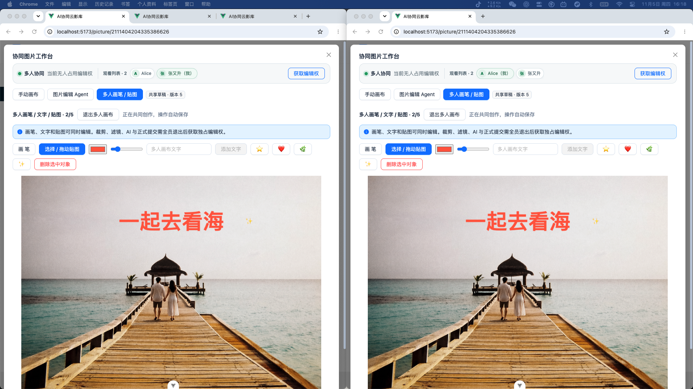
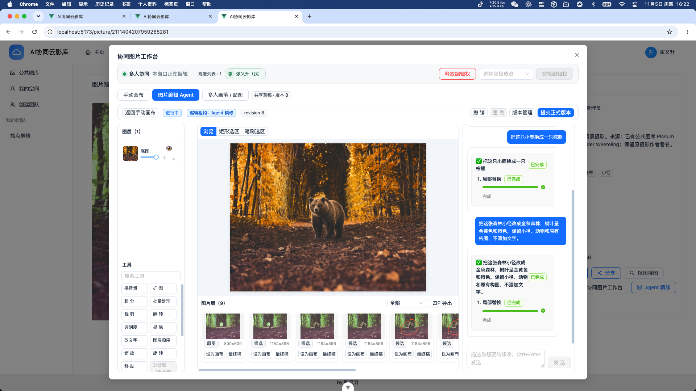
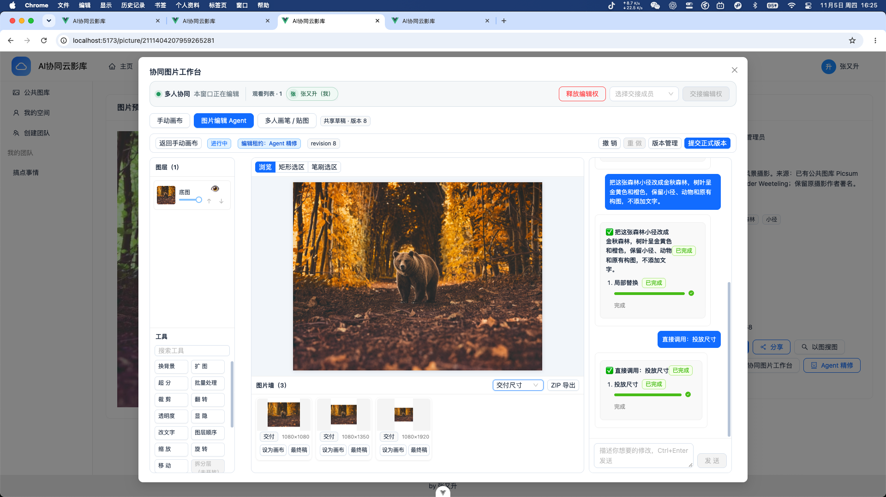
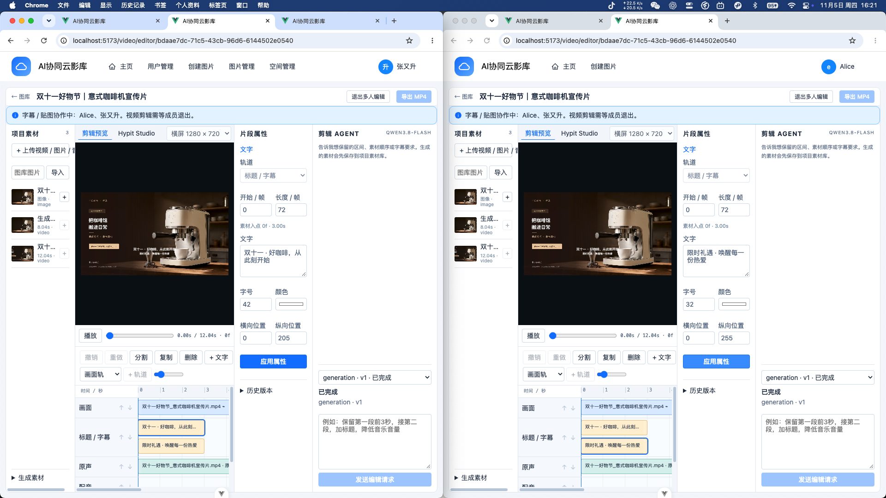
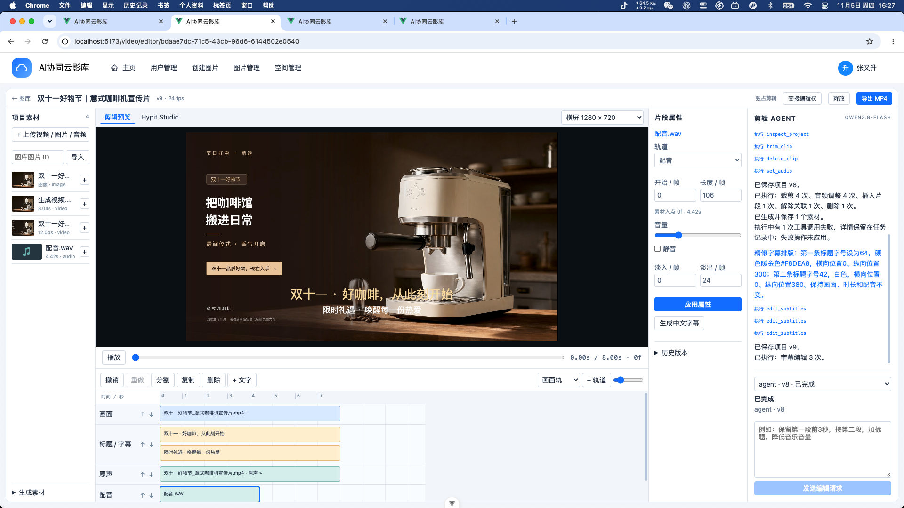
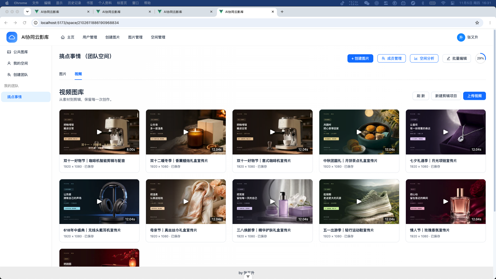
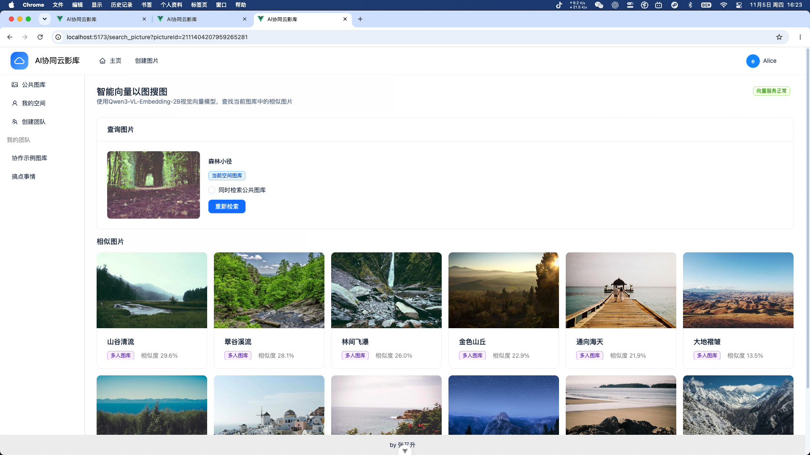
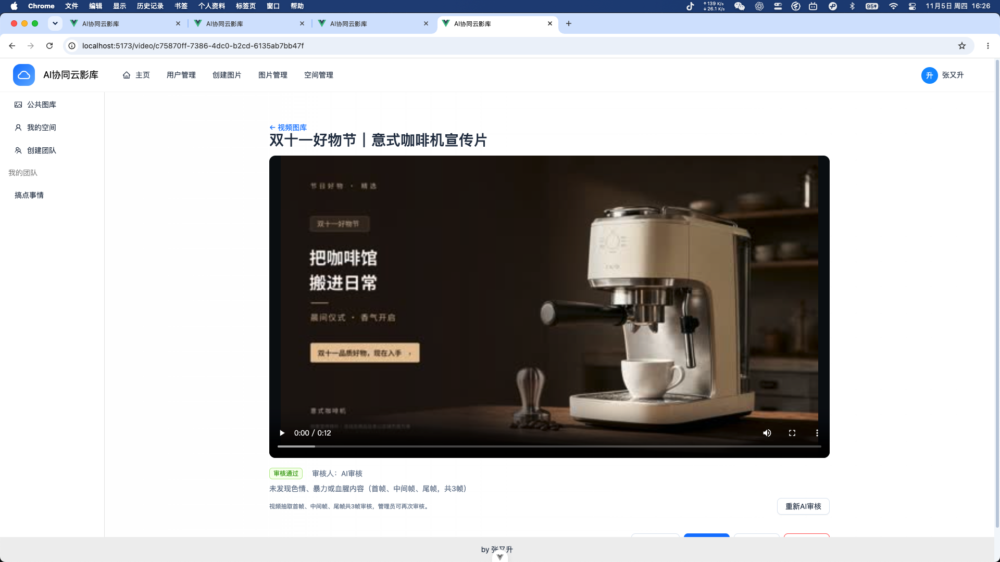

# AI 协同云影库

集多人协作、图片精修、视频剪辑、智能检索与内容审核于一体的 AI 创作平台。

以下均为「搞点事情」团队空间的实际操作截图，协作账号为 zhang 和 alice。

## 多人图片协同编辑

两人同时添加文字、拖动贴图，共享画布实时同步并自动保存。

## 图片 Agent 编辑

用自然语言修改画面：保留主体与构图，将森林切换为金秋风格。

一键生成 1:1、4:5、9:16 投放物料，统一保存在图片墙中。

## 多人视频协同编辑

两人共同编辑字幕，同步预览画面、文案与时间线。

## 视频 Agent 编辑

一句话完成片段裁剪、原声音量调整与中文配音，再继续精修字幕排版。

导出成片，保存回团队图库。

## 以图搜图

从团队图片出发检索相似素材，展示相似度与素材来源。

## AI 审核

自动抽取视频首帧、中间帧和尾帧，返回审核结论与原因，支持重新审核。

